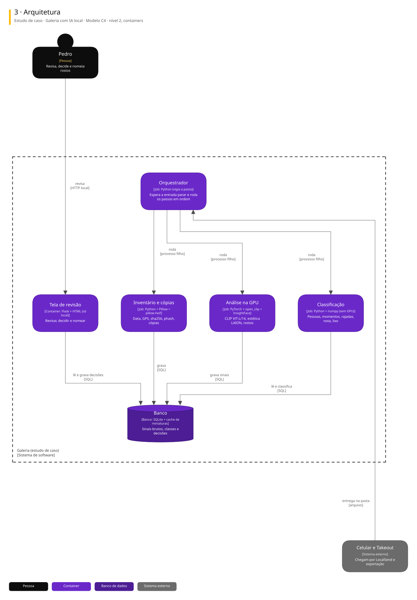

# Arquitetura

Uma vista do sistema, numa notação padrão.

| Vista | Notação | Responde |
|---|---|---|
| Arquitetura | C4, nível 2 | De que partes o sistema é feito e com quem conversa |

## Estudo de caso · Galeria com IA local

Estudo de reconhecimento de imagem com IA local: uma esteira em Python inventaria o acervo, acha cópias, extrai sinais na GPU uma vez (CLIP, estética LAION, InsightFace) e classifica sem GPU. Tudo na máquina; a galeria online não foi feita.

### Arquitetura

Para editar: [estudo-galeria-ia.excalidraw](./estudo-galeria-ia.excalidraw), que abre em [excalidraw.com](https://excalidraw.com) ou na extensão Excalidraw do VS Code.

## De onde vêm

Os diagramas são gerados a partir do Sinapse, o vault onde o Pedro organiza notas e projetos. Mudança feita direto aqui some na próxima publicação: o lugar de mudar é a especificação no Sinapse.
