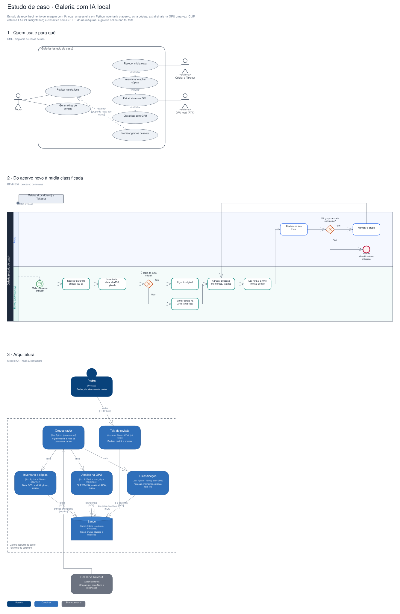

# Arquitetura

Diagramas gerados a partir do Sinapse (o segundo cérebro do Pedro). Cada projeto tem três vistas,
cada uma numa notação padrão:

1. **Quem usa e para quê**: UML, diagrama de casos de uso.
2. **O processo principal**: BPMN 2.0, com raias por quem executa.
3. **A arquitetura**: modelo C4, nível 2 (containers).

## Estudo de caso · Galeria com IA local

Estudo de reconhecimento de imagem com IA local: uma esteira em Python inventaria o acervo, acha cópias, extrai sinais na GPU uma vez (CLIP, estética LAION, InsightFace) e classifica sem GPU. Tudo na máquina; a galeria online não foi feita.

Editável: [`galeria-pessoal.excalidraw`](./galeria-pessoal.excalidraw), abre em [excalidraw.com](https://excalidraw.com) ou no VS Code com a extensão Excalidraw.

A fonte destes arquivos é o vault do Sinapse (`09-DESENHOS/`); alterações feitas aqui são sobrescritas na próxima publicação.
